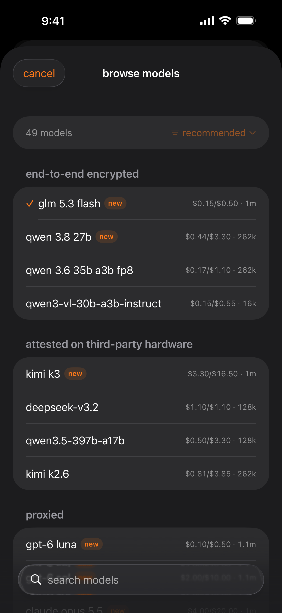
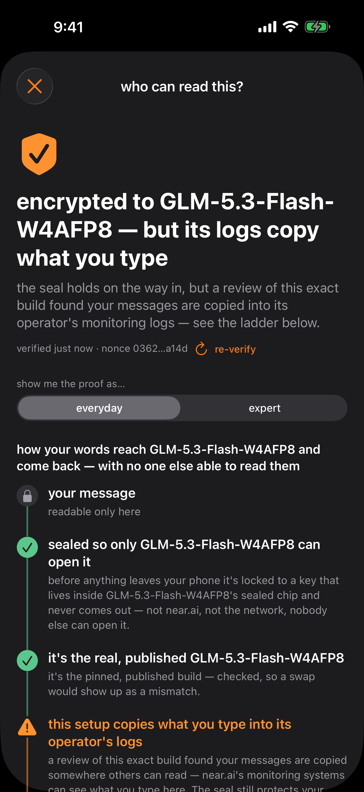
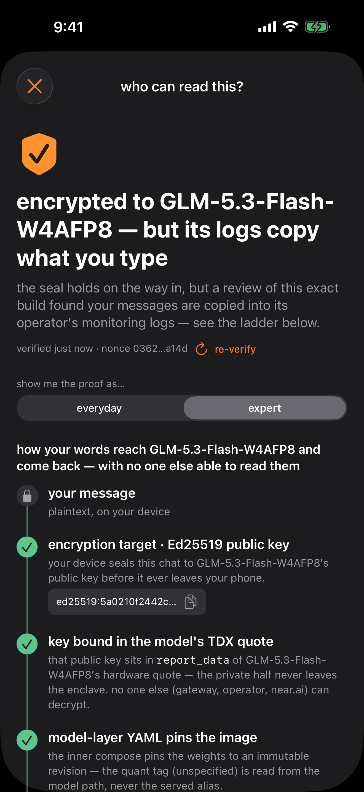
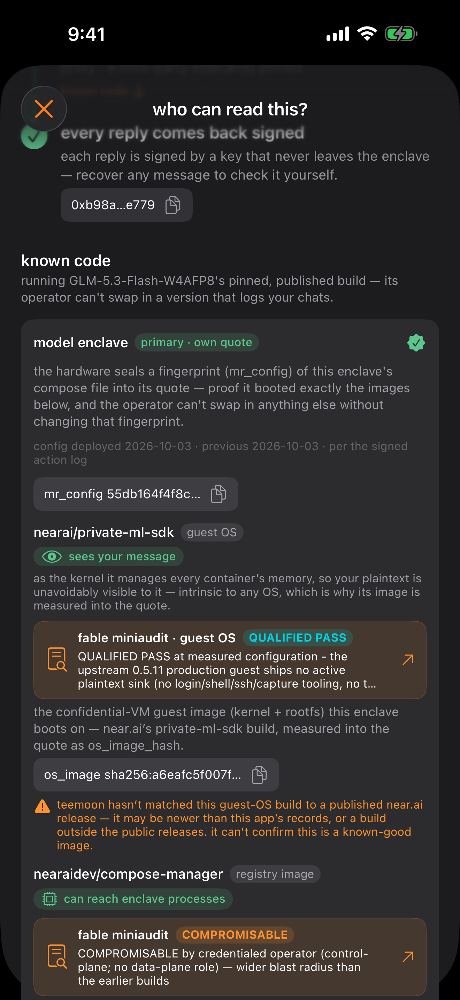
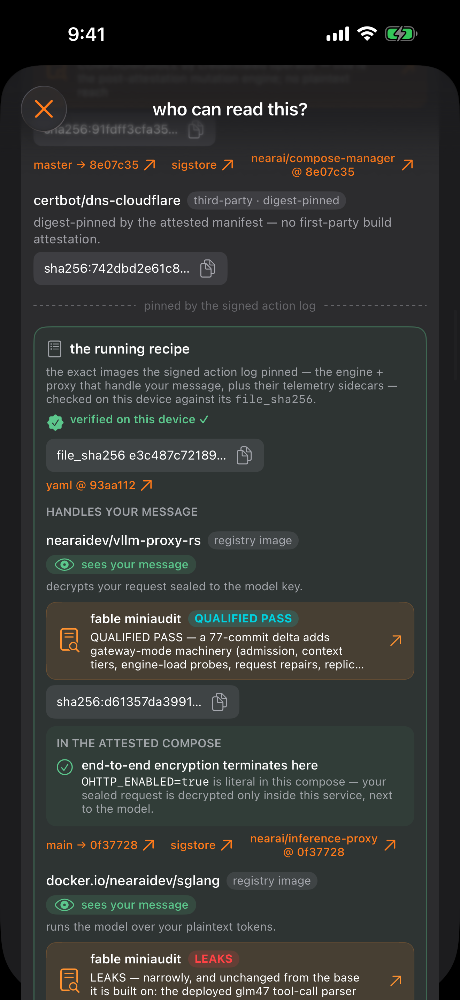

# attestation & verification

on the near.ai confidential-inference path, teemoon does end-to-end encryption into a TEE and
verifies the attestation itself, on the phone, rather than trusting the server's word for it.
this is the full account — what the app checks, how it's surfaced, and, just as carefully,
what it does not prove. for the product overview and the three places a model can run, see
[README.md](README.md); the honesty rule behind all of it lives in [SECURITY.md](SECURITY.md).

## in the app

- An attestation panel showing every check the app ran for the current session, plus
  per-response signature verification — a reply accepted on gateway trust alone is counted
  apart, never as verified.
- A generated self-verification script: copy a standalone python3-stdlib program that fetches
  *fresh* attestations with its own nonces, re-runs near.ai's documented checks on your own
  machine, and compares the live service against what your session saw. `--full` clones
  near.ai's reference verifier for the deep suite.
- Fable miniaudits — every attested image and manifest that can touch your decrypted message
  (found from the enclave's measured compose by `PlaintextExposure`) gets a source-level
  plaintext-exfiltration review — *can it copy your message anywhere but the model?* — surfaced
  in-app with its verdict (e.g. `QUALIFIED PASS`, `PRIVATE`) and keyed to the
  [teemoonai/audits](https://github.com/teemoonai/audits) repo.

  
   <em>browse the near.ai catalog — grouped by confidentiality tier, with pricing and context length</em>

## Verification

"trust me" is not a security model, so on the near.ai path the app performs the
checks itself rather than trusting a server that reports them — and a failed
check blocks the send:

<table>
  <tr>
    <td align="center">
      
    </td>
    <td align="center">
      
    </td>
  </tr>
  <tr>
    <td align="center"><em>everyday — the plain-language ladder</em></td>
    <td align="center"><em>expert — the encryption binding</em></td>
  </tr>
  <tr>
    <td align="center">
      
    </td>
    <td align="center">
      
    </td>
  </tr>
  <tr>
    <td align="center"><em>expert — the known code, with Fable miniaudit verdicts</em></td>
    <td align="center"><em>expert — the running recipe, and where the plaintext is</em></td>
  </tr>
</table>

- **TDX quote** — full DCAP verification via `dcap-qvl` (the same library near.ai's own
  verifier uses), including Quoting-Enclave report binding and TCB-status evaluation
  (`DCAPVerifier`); the hand-rolled `TDXQuoteVerifier` stays on as a display parser and
  cross-check tripwire. For the **gateway**, the quote's MRCONFIGID is checked against the hash of
  the compose manifest it serves, which ties the gateway to that launch config. MRTD and the
  RTMRs are not compared against a published build, and the **model node's** quote is DCAP- and
  nonce-checked but its measurements are not yet bound to a config.
- **GPU evidence** — the `nvidia_payload` is nonce-checked for freshness and submitted to
  NVIDIA's Remote Attestation Service (`NRASService`).
- **E2EE** — near.ai's E2EE v2 protocol (`E2EEPeer`): ephemeral X25519 ECDH, HKDF-SHA256,
  XChaCha20-Poly1305 via `XChaChaPoly`. The encryption target is the model's **Ed25519** public
  key (converted to X25519 for the ECDH); it is bound to the model enclave by matching its full
  32 bytes against the first 32 bytes of the model quote's `report_data`
  (`e2eeKeyBoundToModelTEE`). Separately, a 20-byte Ethereum-style address — near.ai's ECDSA
  *response-signing* key, not the encryption key — is matched against the first 20 bytes of the
  gateway/GPU quote's `report_data` (`signingKeyBoundToHardware`), and each reply's signature is
  verified against it. The message fields are sealed in the request body — each sealed field
  carries its own ephemeral X25519 public key in the wire envelope — while near.ai's custom HTTP
  headers carry the protocol version and the two Ed25519 identities: `X-Encryption-Version: 2`,
  `X-Encrypt-All-Fields: true`, and the `X-Client-Pub-Key` / `X-Model-Pub-Key` that bind the
  seal to the attested model. So the payload is encrypted *to the model*, not just for the TLS
  hop, and the gateway relays ciphertext it holds no key to open.

  On the hand-written crypto, three facts up front: **HChaCha20 (XChaCha's key-derivation
  step) is the only cipher primitive on this path implemented in Swift — the AEAD itself is
  CryptoKit's `ChaChaPoly`**, so no hand-rolled code encrypts or authenticates a byte. Its
  known-answer tests are the `draft-irtf-cfrg-xchacha-03` vectors, not self-generated ones.
  XChaCha exists here at all only because CryptoKit ships IETF ChaCha20-Poly1305 and not
  XChaCha; the Ed25519→X25519 conversion (TweetNaCl's public-domain field arithmetic,
  operating on public keys only) rejects small-order/degenerate public keys before a peer
  can be built.
- **Provenance and measured config** — the enclave's image digests are checked
  against published Sigstore signatures, and its compose is parsed on device
  (`PlaintextExposure`) to identify which images ever see your message decrypted.
  The gateway's compose is the measured one (bound by MRCONFIGID). The model node's
  compose, its hashes and its OS image hash come from the node's report as served and are
  not yet bound to its quote, so they say what near.ai reports it runs, not what the quote proves.
- **Per-response signatures** — the signer is *recovered* from each secp256k1 signature
  (EIP-191 ecrecover), or checked against the attested key for Ed25519, and must be a key the
  model node's quote binds in its report_data. The signed text is compared whole against what
  teemoon sent and received: `<model>:<request sha256>:<response sha256>` for a model-node
  (`provider_tee`) signature, with no model prefix for a gateway one (content binding). Any
  other `signing_algo` or `signature_kind` is rejected. Keccak-256
  — Ethereum's pre-NIST padding, absent from CryptoKit — is the one other hand-implemented
  primitive here; it hashes only public data, and the ECDSA recovery itself is libsecp256k1.
  A gateway-kind signature, even a valid one by the bound gateway key, is surfaced as
  `.unverified(.gatewayTrustOnly)` and counted separately, never reported as verified: it
  shows the gateway relayed those bytes, not that the model wrote them.

Failures are loud: a decrypt failure fails the stream rather than passing ciphertext through,
and a failed check is rendered as a failed check. `AttestationSummary` holds the pass/fail
logic as a plain value type so it can be unit-tested away from SwiftUI.

Attestation proves *which* code is running; it does not tell you whether that
code leaks your plaintext. So beyond the live checks, the attested enclave gets
read: the attestation surfaces the exact images and manifests running inside it,
and a **Fable miniaudit** reads every one of them, asking a single question — can
this component copy your message anywhere but the model? Those per-component
plaintext-exfiltration reviews, keyed to exact attested digests, fail-closed and
never overclaiming, live in the
[teemoonai/audits](https://github.com/teemoonai/audits) repo; the app links to the
review for the exact running identity, and shows no link when there isn't one.

You don't have to trust the app's own verdict either: it generates a standalone
python3-stdlib self-verification script that fetches *fresh* attestations with
its own nonces, re-runs near.ai's documented checks on your own machine, and
compares the live service against what your session saw.

### what this does not prove

Every check above is a real check, and none of them add up to a proof that nobody can read
your conversation. The gaps below are structural, not bugs:

- **Metadata is not sealed, by protocol design.** `encryptRequestBody` seals message content,
  `name`, `refusal`, `tool_calls`, the tool schemas and `tool_choice`, and passes the rest of
  the request through (`E2EEPeer.swift:114-192`). Model id, sampling parameters (including the
  output cap, `max_tokens`, and since 1.0.6 the reasoning level, `reasoning_effort`: "low" by
  default, "high" on Think Harder), the sequence of roles, and the count and ciphertext length
  of your messages stay readable to the gateway. Android seals the same set.
- **A per-chat routing id, to three cloud providers.** So that a provider can reuse its cache
  for a chat's next turn, requests to Fireworks (`x-session-affinity`), xAI (`x-grok-conv-id`)
  and OpenRouter (`x-session-id`) carry an id that stays the same for that chat across launches.
  It is a keyed hash of the chat's id (HMAC-SHA256 under a 32-byte secret kept on the device:
  on iOS a Keychain item that is AfterFirstUnlock and not synchronizable, so it is not in iCloud
  Keychain but is included in encrypted device backups; on Android a non-exportable Android
  Keystore key), so it reveals
  neither the chat's content nor its id, but it does let that provider link a chat's turns to
  each other. It is never sent to near.ai, NVIDIA, Brave or a home server (`SessionAffinity.swift`;
  Android `SessionAffinity.header`).
- **Two failures are deliberately not fatal.** An out-of-date TCB — genuine Intel silicon
  behind on patches — is flagged and the session continues. Any other TCB status (revoked,
  configuration or SW-hardening needed, unknown) fails the quote, as near.ai's own SDK does,
  and so does a quote that fails verification (`DCAPService.swift`, `isAccepted`;
  `ConfidentialSession+Verdict.swift:66-71`). And an image digest with no published
  attestation (a clean GitHub 404) keeps the session off green without gating the send,
  because the seal to the attested key is intact
  (`ConfidentialSession+Verdict.swift:182-184`, `:256-261`).
- **The TLS check is about the model's direct host, not the chat connection.** The probe goes to
  the model's direct host, accepts any server certificate, then compares its SPKI hash to the
  fingerprint bound in that host's quote (`TLSAttestationVerifier.swift`), and that quote is
  DCAP-verified like the others. Chat itself goes to the gateway over ordinary
  CA-validated TLS, which this check does not cover. Its value is detecting an interceptor in
  front of the direct host; it prevents nothing, which is why the probe carries no credentials.
- **Rekor gives an inclusion promise, not an inclusion proof.** The signed entry timestamp
  verifies under the pinned Rekor key; no Merkle proof is fetched
  (`ImageProvenance.swift:25-27`).
- **A gateway-trust-only response is not per-response proof.** It is counted separately and
  never shown as verified (`TEESignatureVerifier.swift`, `gatewayTrustOnly`): the attested
  gateway signed it, but no model-node key did. A request near.ai serves in plaintext (no
  E2EE) comes back gateway-signed.
- **The roots are trusted, not proven.** Intel's SGX Root CA and Sigstore's Fulcio/Rekor keys
  are pinned in the binary (`IntelRootCA.swift:23`, `SigstoreTrustRoot.swift:34`, `:53`).
  NVIDIA's verdict arrives as a JWT from `nras.attestation.nvidia.com` and is verified before it
  counts: ES384 against NVIDIA's published JWKS, the issuer, the validity window and the
  request's `eat_nonce` (`NRASService.swift`, `checkToken`); an unreachable JWKS or an unknown
  key id is reported as inconclusive, never as a pass. What stays trusted is NVIDIA itself: the
  verdict is NVIDIA's judgment of the GPU evidence, not the app's. Attestation moves trust to
  the silicon vendors; it does not remove it.
- **The shipped binary is not reproducible.** You can build from this source, but there is no
  published hash to check a shipped build against.
