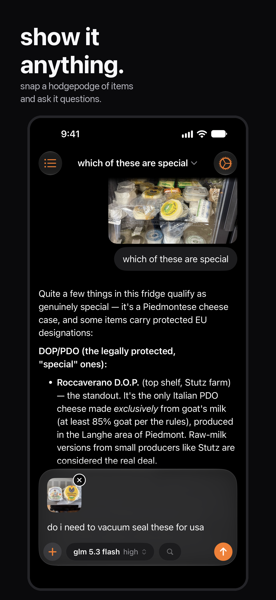
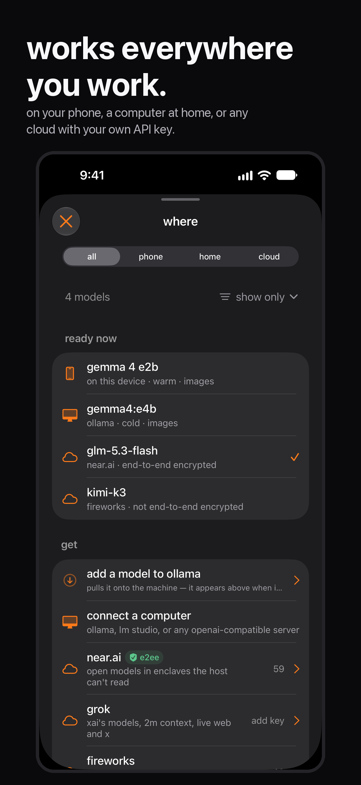
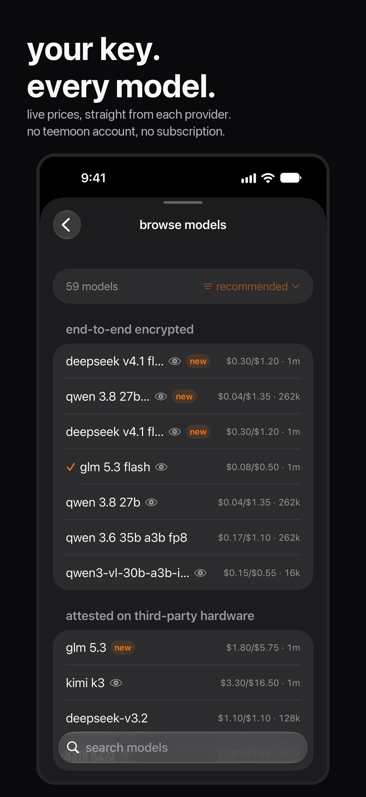
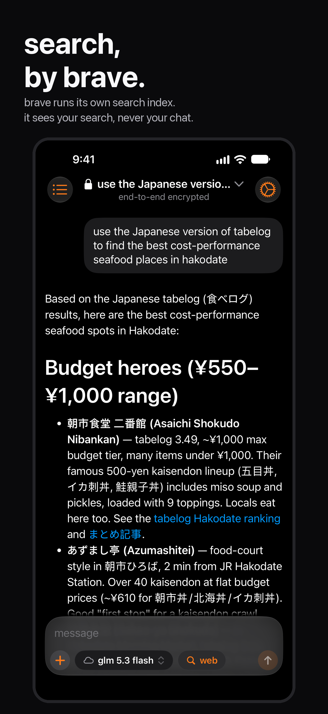

# teemoon

**private AI chat, your key.**

your key, any model — on the phone, a machine you own, or a cloud you pick. no account, no subscription, no teemoon server.

[teemoon.ai](https://teemoon.ai) · [App Store](https://apps.apple.com/app/id6762371161) · [changelog](CHANGELOG.md) · [audit](https://github.com/teemoonai/audits/blob/main/client/teemoon-ios/v1.1.0-6c5f7a2.md) · beta builds on [TestFlight](https://testflight.apple.com/join/WHZ9VPms) · iPhone, iOS 18.6+

<p align="center">
  
</p>

teemoon is a private AI chat app. there is no teemoon server: your phone talks directly to the model you pick. run a model on the phone, connect a computer you own, or paste a cloud API key. keys live in the iOS Keychain. chats stay on the device — SwiftData, no iCloud.

this repository is the whole client — there's no teemoon account system or backend behind it. the one part you can't audit from here is the remote model server you connect to; verifying that server without having to trust it is what the attestation code does — see [`ATTESTATION.md`](ATTESTATION.md).

## new in 1.1.0

- **images.** paste one into your chat, share one from any app with the iOS share sheet, or take one in teemoon. JPEG, PNG and GIF are decoded with Wuffs, a memory-safe image decoder; teemoon strips location and camera details and keeps only its own clean copy.
- **near.ai Private Chat import.** near.ai shut down Private Chat on November 15, 2026. bring your exported chats over, images included: settings → chats → import from near.ai.

full list: [`CHANGELOG.md`](CHANGELOG.md).

## features

- **three places to run a model.** on the phone: Gemma 4 E2B (the default) or E4B via LiteRT-LM, tool calling included, no key, works offline. on a computer you own: ollama, LM Studio, or any OpenAI-compatible server (llama.cpp included). in a cloud you pick: bring your own key for near.ai, Grok, Fireworks, OpenRouter, NVIDIA, Brave Answers, and other OpenAI-compatible providers.
- **verified end-to-end encryption to near.ai's attested enclaves.** before a message is sealed, the phone itself checks a near.ai model enclave's Intel TDX quote with DCAP, its GPU evidence with NVIDIA's attestation service, and, in a separate probe of the model's host, that its certificate is the one its attestation names (the chat connection itself is ordinary TLS with the message sealed inside); enclave images are traced to published source where near.ai publishes a signed build record. a failed check blocks sending; a soft degrade asks first. one limit, found after release: the app checks the first enclave near.ai lists, and near.ai's enclaves for a model share one key, so the other enclaves can open the message too — see [known issues](CHANGELOG.md#known-issues). every cloud provider other than near.ai is plain TLS, and the model row says so. what the checks do and do not prove: [`ATTESTATION.md`](ATTESTATION.md#what-this-does-not-prove).
- **audited.** every release is reviewed against its exact source and the review is published, findings included: [teemoonai/audits](https://github.com/teemoonai/audits). it is teemoon's own AI-assisted review, not an audit by an outside firm.
- **images.** choose from your library, paste, share from another app, or take one with the camera, and send it to a model that reads images. photos go only to the model you send them to, and on near.ai's attested models they are sealed with the text. the camera is used only when you take a photo. the models on the phone read images too, when the phone has the memory for it; teemoon checks when you send and says so when it can't.
- **near.ai Private Chat import.** import your near.ai Private Chat export file, images included (settings → chats → import from near.ai). it is read and saved on the phone only.
- **web search the model can call.** Brave's LLM Context API as a `web_search` tool, with inline citations, a sources sheet, and a marker where a turn starts fresh. the model receives facts, not raw page markup. (distinct from Brave Answers, the search-grounded provider preset — different API, different key.)
- **chat search.** full-text search over your own chat history — an on-device SQLite FTS5 index beside the store, so it works offline and nothing leaves the phone. a result tap lands on the matching message.
- **the request as sent.** a last-request view shows exactly what went over the wire — URL, headers, request body, any tool calls, and response body. always shown when a request fails; on every request with developer mode on. key-bearing headers are redacted on the copy path.

also: no account, no subscription, no analytics; background model downloads that survive the app being closed and resume where they stopped; a model browser that reads context length, tool support and vision from each provider's catalog; stop a reply mid-stream, retry a failed message, and a notice when a server silently truncates the conversation to fit its context window.

only on iOS: a Siri shortcut sends a question to the current model.

## where your model runs

<table>
  <tr>
    <td align="center">
      
    </td>
    <td align="center">
      
    </td>
    <td align="center">
      
    </td>
  </tr>
  <tr>
    <td align="center"><em>every model in one list — labeled per row</em></td>
    <td align="center"><em>your key, live prices</em></td>
    <td align="center"><em>web search through Brave</em></td>
  </tr>
</table>

- **this phone** — Gemma 4 E2B/E4B via LiteRT-LM, tool calling included. no key, works offline, and nothing leaves the device unless you turn on web search (its queries go to Brave).
- **a computer you own** — ollama, LM Studio, or any OpenAI-compatible server (llama.cpp included). the app can even browse and download models onto your own ollama server.
- **a cloud you pick** — bring your own key for near.ai, Grok, Fireworks, OpenRouter, NVIDIA, Brave Answers, and other OpenAI-compatible providers. (an Anthropic key does not work: the app speaks chat/completions, not `/v1/messages` — Claude models are reachable only proxied via near.ai.)

**end-to-end encryption is near.ai's attested enclaves only. every other cloud provider is plain TLS. the app labels this per row** — that's the first screenshot above, and the honesty rule the project is built around: [`SECURITY.md`](SECURITY.md) treats copy that overstates what the code verifies as a security bug.

## security and audits

- **what the attestation checks prove, and what they don't** — [`ATTESTATION.md`](ATTESTATION.md), including [what this does not prove](ATTESTATION.md#what-this-does-not-prove).
- **security policy and reporting** — [`SECURITY.md`](SECURITY.md). please report vulnerabilities through [private vulnerability reporting](https://github.com/teemoonai/teemoon-ios/security/advisories/new), not a public issue.
- **the 1.1.0 audit** — [v1.1.0-6c5f7a2](https://github.com/teemoonai/audits/blob/main/client/teemoon-ios/v1.1.0-6c5f7a2.md). its verdict, in its own words: "QUALIFIED-PASS — no key and no message was found going to anyone but the chosen provider; one medium-severity issue was found after release (the app verifies one of several near.ai enclaves that share a key); three low-severity issues are open, two accepted for 1.1.0 and one a carried product decision; a real iPhone was not part of the review".
- **known issues** — listed per release in [`CHANGELOG.md`](CHANGELOG.md#known-issues), each with the audit that found it.
- **per-model source audits of near.ai's enclaves** — [teemoonai/audits](https://github.com/teemoonai/audits): plaintext-exfiltration reviews keyed to exact attested identities.

## what's in the tree

three local Swift packages live in [`Packages/`](Packages):

- `LiteRTLM` — Google's LiteRT-LM runtime, used for on-device inference
- `ModelBackend` — model execution and download plumbing
- `TDXQuoteVerifier` — hand-rolled Intel TDX quote parsing

remote dependencies are pinned in `teemoon.xcodeproj/project.xcworkspace/xcshareddata/swiftpm/Package.resolved`. the notable ones are [AnyLanguageModel](https://github.com/huggingface/AnyLanguageModel) (the `LanguageModel` protocol teemoon conforms to), [dcap-qvl-swift](https://github.com/Phala-Network/dcap-qvl-swift) (DCAP verification), and [swift-secp256k1](https://github.com/21-DOT-DEV/swift-secp256k1). [textual](https://github.com/gonzalezreal/textual) (Markdown rendering) is vendored at `Vendor/textual`, not consumed by URL — see [`Vendor/textual/VENDORING.md`](Vendor/textual/VENDORING.md).

one transport per place:

| place | transport |
|---|---|
| this phone | `LiteRTTransport` — Gemma 4 E2B/E4B via LiteRT-LM |
| home, cloud | `HTTPTransport` over HTTPS/SSE; on near.ai the request is sealed by `E2EEPeer` |

`GenerationEngine` is transport-agnostic: the tool-calling loop, message construction, and streaming behave identically whether a model runs on near.ai or on the phone. output pacing is a `CADisplayLink` in the view layer; the model layer publishes tokens unthrottled.

## building

requires Xcode 26 or newer, and **`git-lfs` installed before you clone**. no API keys are needed to build or to run the test suite.

```
brew install git-lfs && git lfs install
git clone https://github.com/teemoonai/teemoon-ios.git
cd teemoon-ios
open teemoon.xcodeproj
```

LFS is not optional, on any platform. `Packages/LiteRTLM/artifacts/` holds a repackaged macOS xcframework (145 MB) that `Package.swift` references by path, and SwiftPM validates that path when the manifest loads. clone without LFS and you get a text pointer instead of the binary, the package fails to resolve, and the iOS build goes down with it. see [`Packages/LiteRTLM/VENDORING.md`](Packages/LiteRTLM/VENDORING.md) for what the artifact is, why it has to be repackaged, and how to reproduce it.

select the `teemoon` scheme and an iOS 26 simulator. the first build resolves Swift packages, so it needs network. the app target is iOS 18.6+; the test targets are iOS 26.4+, and any simulator runtime at or above that runs the suite. the project also carries a macOS destination and the Vision device family for development; the iPhone app is what ships.

## testing

```
xcodebuild test -project teemoon.xcodeproj -scheme teemoon -destination 'platform=iOS Simulator,name=iPhone 17 Pro' -only-testing:teemoonTests
```

the unit suite is offline: no keys, no network. engine tests drive the real production path through a stub `URLProtocol` — streaming, the tool loop, E2EE seal/decrypt round-trips, decrypt failure, and HTTP error draining.

**a public clone does not pass the whole suite today.** since 1.0.6 some tests read shared test fixtures from `conformance/` and `docs/DATA_MODEL.md`, which are not in the public tree yet, so those tests fail from a public clone and the public CI run is red. adding them to the public tree is planned for 1.1.1.

`NearAIBenchmarkTests` and `GLM5BraveSearchTests` hit live paid services and are permanently `.disabled`. to run them, remove the trait locally and supply `NEAR_AI_API_KEY` / `BRAVE_API_KEY` as environment variables or in `~/.NEAR_AI_API_KEY` / `~/.BRAVE_API_KEY`. note that `ProviderSmokeTests`, `ProductLiveEndpointTests`, and `GroundingLiveTests` self-activate when those key files exist — if you have e.g. `~/.NEAR_AI_API_KEY` present, running the full suite makes real (possibly paid) network requests. to keep a run offline, remove or rename the key files, or skip those suites the way CI does (the `-skip-testing:` list in `.github/workflows/test.yml`).

`teemoonUITests` includes a screenshot suite used to generate App Store captures.

## layout

```
teemoon/App/            app entry, intents, platform glue
teemoon/Chat/           SwiftData models, chat view model, images, near.ai import
teemoon/Inference/      generation loop, transports, SSE parsing, tools
teemoon/Confidential/   attestation, quote verification, E2EE
teemoon/Providers/      provider presets, catalogs, config, keychain
teemoon/Presentation/   provider presentation for the Where UI
teemoon/Settings/       appearance and app settings
teemoon/Support/        hang reporter, background work
teemoon/Views/          SwiftUI views (Chat/, Onboarding/, Settings/, Where/)
teemoonShare/           the share extension (images shared in from other apps)
teemoonTests/           offline unit tests
teemoonUITests/         UI and screenshot tests
Packages/               local Swift packages
Vendor/                 vendored third-party packages
```

the conversation store (`teemoon/Chat/`, SwiftData) is versioned via `SchemaVersioning.swift`: every schema change is an explicit migration stage, and a failed store open never deletes data — the app runs in-memory for that session, says so, and leaves the file untouched on disk.

## documentation

this repository publishes the code. most of the project's internal design documents — architecture, attestation flow, data model, the design system — are not part of the published tree; a code comment that cites a bare section number (§N) is citing one of them.

what does ship, and is meant to stand on its own:

- **changes per release** — [`CHANGELOG.md`](CHANGELOG.md), with the full 1.1.0 detail in [`docs/releases/1.1.0.md`](docs/releases/1.1.0.md).
- **attestation and what it proves** — [`ATTESTATION.md`](ATTESTATION.md), including [what this does not prove](ATTESTATION.md#what-this-does-not-prove).
- **audits** — the [teemoonai/audits](https://github.com/teemoonai/audits) repo: one page per app release, and per-model reviews of near.ai's enclaves.
- **vendoring** — [`Vendor/textual/VENDORING.md`](Vendor/textual/VENDORING.md) and [`Packages/LiteRTLM/VENDORING.md`](Packages/LiteRTLM/VENDORING.md): why each is an in-tree copy, every delta from upstream, and how to bump one without losing a patch.
- **contributing** — [`CONTRIBUTING.md`](CONTRIBUTING.md).
- **security policy** — [`SECURITY.md`](SECURITY.md).
- **third-party attributions** — [`THIRD_PARTY_NOTICES.md`](THIRD_PARTY_NOTICES.md).

not yet published: the `conformance/` test fixtures (see [testing](#testing); planned for 1.1.1). beyond that, the source is the documentation: the attestation and E2EE files in `teemoon/Confidential/` carry their protocol notes and trust-model caveats in file headers.

## contributing

bug reports and pull requests are welcome. fixes should come with a regression test, and the unit suite must stay offline and green.

copy that overstates what the code verifies is treated as a bug of the same severity as a missing check. if you change anything on the attestation or E2EE path, the claims in the UI have to move with it.

teemoon is AGPL-3.0 and is also distributed through the App Store by the copyright holder, so external contributions may require a CLA before they can be merged. open an issue before writing anything substantial.

security issues: please don't open a public issue — use [private vulnerability reporting](https://github.com/teemoonai/teemoon-ios/security/advisories/new).

## cryptography notice

this distribution includes cryptographic software. the country in which you currently reside may have restrictions on the import, possession, use, and/or re-export to another country of encryption software. before using it, check your country's laws and regulations concerning the import, possession, use, and re-export of encryption software.

the app declares `ITSAppUsesNonExemptEncryption = NO` for App Store export compliance. that is a deliberate claim, not an accident: every cryptographic operation teemoon performs uses standard, published algorithms (X25519/Ed25519, XChaCha20-Poly1305, HKDF, SHA-2, P-256 ECDSA for Sigstore verification, secp256k1 ECDSA recovery with Keccak-256 for response-signature verification, and TLS via the OS) for authentication, integrity, and end-to-end encryption of user content — the category 5, part 2 "standard algorithms" exemption under EAR §740.17(b) / the equivalent mass-market provisions. no proprietary or non-standard cryptography is implemented or exposed.

## license

copyright 2026 ringzero ventures llc

licensed under the GNU AGPLv3: https://www.gnu.org/licenses/agpl-3.0.html

teemoon began as a fork of [fullmoon](https://github.com/mainframecomputer/fullmoon-ios) (© 2024 Mainframe Computer, Inc.), originally MIT-licensed. that notice and other third-party attributions are preserved in [`THIRD_PARTY_NOTICES.md`](THIRD_PARTY_NOTICES.md).
